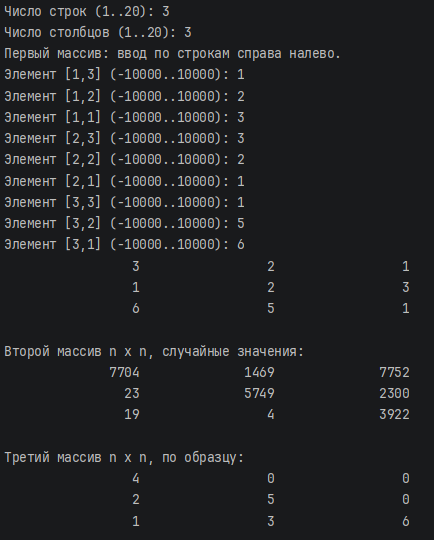
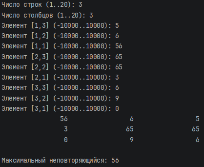
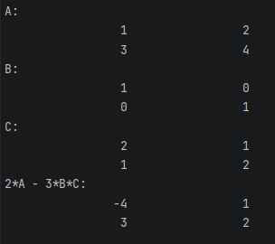
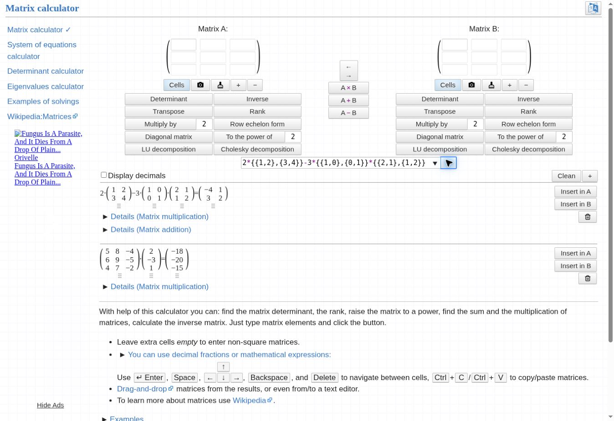
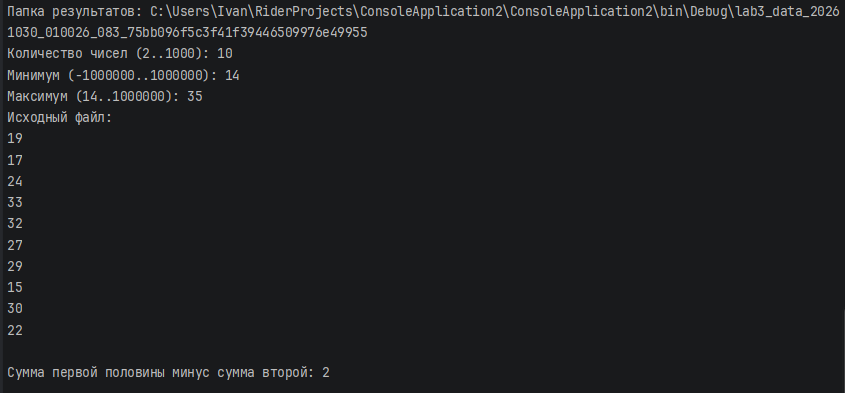
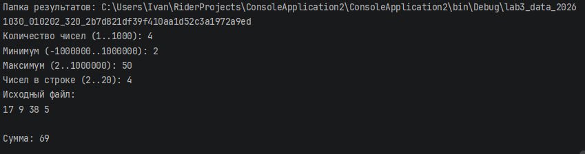
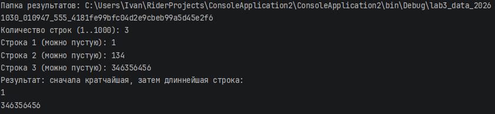

Гладышев Иван, ЛА-3

# Лабораторная работа №3

Массивы и файлы. Во всех восьми заданиях выполнена задача 1. Код размещён в main.cs и tasks.cs одного консольного проекта. Меню: задание → номер → ввод данных. Готовые данные из условия не подставляются.

## Задание 1

### Задача 1 Заполнение двумерных массивов

#### Текст задачи

Создать три массива конструкторами одного класса. Первый n × m заполняется с клавиатуры по строкам справа налево. Второй n × n: ниже главной диагонали целые случайные числа от −17 до 36, на диагонали и выше — от 100 до 10000. Третий заполняется по схеме из условия.

#### Алгоритм решения

1. В Matrix хранить единственное поле double\[,\] data. Размеры получать через свойства.

2. Первый конструктор обходит строки сверху вниз, столбцы — от m − 1 до 0.

3. Второй конструктор выбирает диапазон по условию i &gt; j.

4. Третий перебирает смещения диагоналей от n − 1 до 0 и заполняет их по направлению вниз и вправо.

#### Тестирование

## Задание 2

### Задача 1 Неповторяющийся максимум

#### Текст задачи

Найти максимальный элемент, встречающийся в двумерном массиве ровно один раз.

#### Алгоритм решения

1. Ввести массив первым конструктором Matrix.

2. Для каждого элемента посчитать число совпадений во всём массиве.

3. Среди элементов с одним вхождением выбрать максимальный.

4. Если таких элементов нет, вывести сообщение; метод возвращает false.

#### Тестирование

## Задание 3

### Задача 1 Матричное выражение

#### Текст задачи

Вычислить 2\*A − 3\*B\*C с использованием перегруженных операторов.

#### Алгоритм решения

1. Ввести A размера n × m, B размера n × k, C размера k × m. Ввод каждой строки справа налево.

2. Перегрузить умножение числа на матрицу, умножение матриц и вычитание матриц.

3. Вычислить Matrix result = 2\*a - 3\*b\*c.

4. Вывести исходные матрицы и результат через ToString() в виде таблицы.

#### Тестирование

### Проверка матричного выражения онлайн

## Задание 4

### Задача 1 Чётные компоненты бинарного файла

#### Текст задачи

Заполнить бинарный файл случайными целыми числами и записать чётные компоненты в другой файл.

#### Алгоритм решения

1. Отдельный метод FillBinary записывает Int32 через BinaryWriter.

2. SelectEven читает значения BinaryReader до конца файла.

3. Если остаток от деления на 2 равен нулю, записать значение в even.bin.

4. Сохранить исходный порядок и вывести содержимое обоих файлов.

#### Тестирование

## Задание 5

### Задача 1 Багаж пассажиров

#### Текст задачи

Найти пассажиров, средняя масса одного места багажа которых отличается от общей средней массы места не более чем на m кг.

#### Алгоритм решения

1. Ввести пассажиров, названия и массы мест багажа, допуск m. Использовать структуры Passenger и BaggageItem.

2. FillBaggage сериализует Passenger\[\] через XmlSerializer. В baggage.bin записываются длина XML и его байты; baggage.xml содержит читаемую копию.

3. Прочитать бинарный контейнер и десериализовать XML.

4. Общую массу разделить на общее количество мест, а не на количество пассажиров.

5. Для каждого пассажира проверить Math.Abs(local − average) &lt;= m.

#### Тестирование

## Задание 6

### Задача 1 Разность сумм половин

#### Текст задачи

В текстовом файле по одному целому числу в строке. Количество чисел чётно. Найти сумму первой половины минус сумму второй.

#### Алгоритм решения

1. Запросить чётное число элементов и диапазон.

2. Отдельный метод FillText создаёт случайные числа по одному в строке.

3. Прочитать строки, проверить чётность количества.

4. Накопить две суммы в long и вернуть их разность.

#### Тестирование

## Задание 7

### Задача 1 Сумма чисел текстового файла

#### Текст задачи

Вычислить сумму целых чисел файла, расположенных по несколько в строке.

#### Алгоритм решения

1. Запросить количество чисел, диапазон и количество чисел в строке.

2. FillText записывает случайные целые числа с пробелами; последняя строка может быть неполной.

3. Читать файл построчно и разбивать строки по пробелам и табуляциям.

4. Преобразовать части в int, накопить сумму в long.

#### Тестирование

## Задание 8

### Задача 1 Самая короткая и самая длинная строки

#### Текст задачи

Переписать в другой текстовый файл самую короткую и самую длинную строки.

#### Алгоритм решения

1. Ввести строки и сохранить их в UTF-8. Пустые строки разрешены.

2. Первую строку принять одновременно за минимум и максимум.

3. Последовательно сравнивать длины остальных строк. При равенстве оставить первую встреченную.

4. Записать в result.txt сначала кратчайшую, затем длиннейшую строку.

#### Тестирование

